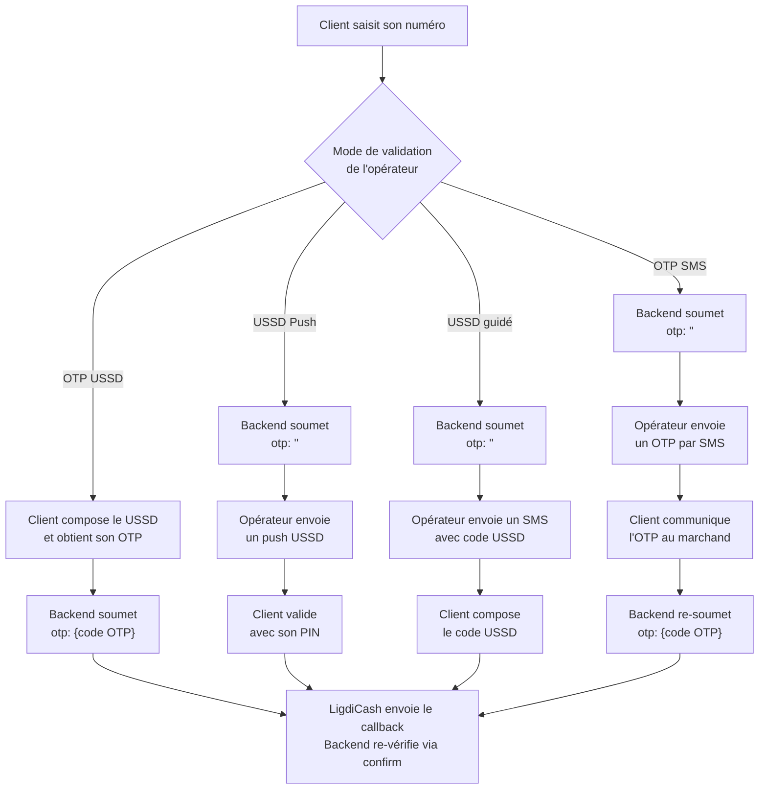

> ## Documentation Index
> Fetch the complete documentation index at: https://developers.ligdicash.com/llms.txt
> Use this file to discover all available pages before exploring further.

# Payin sans redirection

> Collectez des paiements directement dans votre interface, sans rediriger votre client vers LigdiCash. Vous gérez l'UX, LigdiCash gère l'opérateur.

Le payin sans redirection vous permet d'intégrer le formulaire de paiement directement dans votre application. Votre client ne quitte pas votre interface : il saisit son numéro de téléphone, valide le paiement selon les instructions de son opérateur, et la transaction est confirmée par callback. Vous avez le contrôle total de l'expérience utilisateur.

Cette méthode demande plus de travail d'intégration que le payin avec redirection : le mode de validation varie selon l'opérateur, et votre UX doit s'y adapter.

## Comment ça fonctionne

Le flux général comporte quatre étapes, dont l'étape 3 varie selon le [mode de validation](https://developers.ligdicash.com/api-paiement/payin-sans-redirect/modes-validation.md) de l'opérateur choisi.

**1. Collecter le numéro du client**

Votre interface recueille le numéro de téléphone mobile money du client, au format sans `+` ni espaces (`22670XXXXXXX`). Selon l'opérateur, vous déterminez le mode de validation à appliquer.

**2. Initier la transaction**

Vous appelez `POST /pay/v01/straight/checkout-invoice/create` (ou les endpoints spécifiques pour le Wallet LigdiCash) avec le numéro du client et, selon le mode, l'OTP déjà collecté ou un champ `otp` vide.

**3. Validation par le client**

Le client valide le paiement selon son opérateur : en répondant à un push USSD, en composant un code USSD, ou en communiquant un OTP reçu par SMS. Dans ce dernier cas uniquement (OTP SMS), vous re-soumettez une seconde requête avec le code.

**4. Confirmation**

LigdiCash envoie un callback à votre `callback_url`. Vous re-vérifiez le statut via l'endpoint `confirm` avec le token stocké à la création avant de finaliser la commande.

## Modes de validation

Le comportement de l'étape 3 dépend de l'opérateur. Quatre modes existent :

| Mode | Déclenchement | Résumé |
| - | - | - |
| **OTP USSD** | Avant soumission | Le client compose un USSD → génère un OTP → vous soumettez avec cet OTP |
| **USSD Push** | Après soumission | L'opérateur envoie un push USSD → le client valide avec son PIN |
| **USSD guidé** | Après soumission | L'opérateur envoie un SMS avec un code USSD → le client compose le USSD |
| **OTP SMS** | Après soumission | L'opérateur envoie un OTP par SMS → le client vous communique le code → vous re-soumettez |

> [card] [Modes de validation — guide complet](https://developers.ligdicash.com/api-paiement/payin-sans-redirect/modes-validation.md)
>
> Comprendre les quatre modes et adapter votre UX à chaque opérateur

## Contraintes importantes

> [!WARNING]
>
> Le champ `external_id` doit toujours être vide (`""`) dans toutes les requêtes payin sans redirection.

> [!NOTE]
>
> Le token retourné à la création est différent du token présent dans le payload du callback. Stockez toujours le token de création côté marchand et utilisez-le pour appeler `confirm` — ne faites pas confiance au token du callback seul.

## Dans cette section

> [card] [Modes de validation](https://developers.ligdicash.com/api-paiement/payin-sans-redirect/modes-validation.md)
>
> OTP USSD, USSD Push, USSD guidé, OTP SMS — comprendre et adapter l'UX

> [card] [Créer une transaction](https://developers.ligdicash.com/api-paiement/payin-sans-redirect/creer-transaction.md)
>
> Paramètres, payload complet et réponse de l'endpoint de création

> [card] [Vérifier le statut](https://developers.ligdicash.com/api-paiement/payin-sans-redirect/verifier-statut.md)
>
> Appeler l'endpoint confirm avec le token de création

> [card] [Opérateurs supportés](https://developers.ligdicash.com/api-paiement/payin-sans-redirect/operateurs/orange-burkina.md)
>
> Une page dédiée par opérateur avec les identifiants, le mode et les exemples

This documentation is built and hosted on [Mintlify](https://mintlify.com), a developer documentation platform.